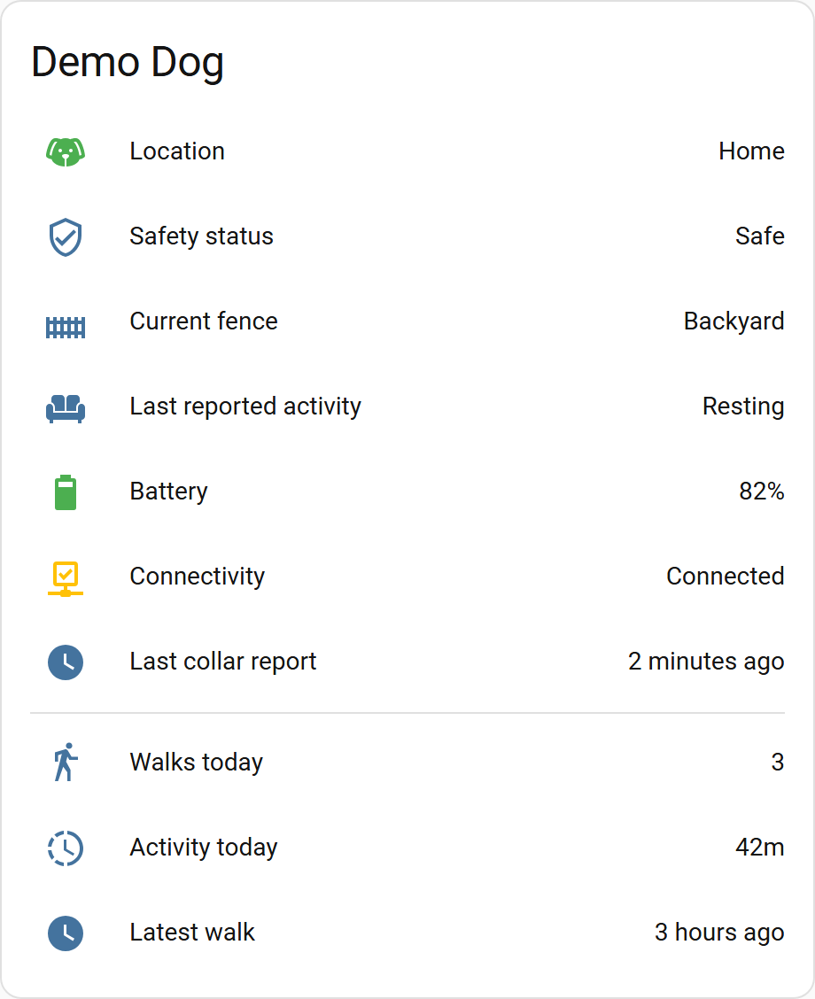

# Halo Collar for Home Assistant

  

A Home Assistant custom integration for [Halo Collar](https://www.halocollar.com/) location, battery, connectivity, activity, and fence telemetry. Physical controls are opt-in.

> [!IMPORTANT]
> This is an **unofficial** integration. It is not affiliated with, endorsed by, or supported by Halo Collar / Protect Animals With Satellites, LLC. It talks to Halo's private mobile/cloud API, which may change or break at any time. Use at your own risk.

> [!WARNING]
> **Experimental fork / beta branch.** This fork extends the [upstream integration](https://github.com/itsreverence/ha-halo-collar) with a manual, encrypted-vault import for Sign in with Apple. It is **not** an approved third-party OAuth client, does **not** support a native browser login within Home Assistant, and has **not** been verified with paired collars. Imported SSO entries are read-only; existing password-authenticated entries retain their separately opted-in controls. Do not use this branch as a pet-safety system. See [experimental SSO instructions](README_SSO_IMPORT.md).

  <picture>
    <source media="(prefers-color-scheme: dark)" srcset="docs/assets/screenshots/dashboard-card-dark.png">
    
  </picture>

An example dashboard card built from this integration's entities, using synthetic demo data.

## Entities

The integration is **telemetry-only by default**. Each collar has:

- A device tracker with provider GPS coordinates. When Halo reports indoors and Wi-Fi, the tracker reports `home`. This does not verify the Wi-Fi network or physical home location, and it does not replace the map coordinates.
- Battery, connectivity, location, fence, calibration, firmware, and diagnostic-status sensors, plus a **Fence breach event** for automations.
- Provider daily/current-period activity metrics and cloud-polled active-walk duration and distance. Durations display in minutes on new installs. Existing installs keep seconds until you pick another unit in the entity's settings. Goal attributes keep Halo's units (seconds or meters), and `progress_percent` is unitless.
- **Last reported activity** shows Halo's latest classification, such as walking or resting. Activity, safety status, current fence, active walk, and fence breach read unknown while **Connectivity** is off, so an old report never looks current. Battery, location, and other readings keep their last values.
- Recent-walk sensors for the newest matching completed walk in the first 30 records returned by Halo. These are supplemental history, not live tracking. Unknown can mean no valid match in that window or an optional history request failure.

The activity labels come from the Halo app. A live response confirmed the field and its integer codes. The label meanings have not been checked against observed behavior yet.

An account-level **Subscription** sensor summarizes subscription limits. Optional physical controls are described under [Options](#options). See [Architecture](docs/ARCHITECTURE.md#platforms) for detailed entity coverage.

## Requirements

- Home Assistant 2024.12 or newer.
- A Halo account with an active Pack Membership Plan and at least one paired collar. The password flow requires the account email and password; the experimental Apple SSO flow requires a previously verified, encrypted credential vault and separate manual import.

## Installation

**Important:** The existing HACS default catalog entry and upstream installation button point to [`itsreverence/ha-halo-collar`](https://github.com/itsreverence/ha-halo-collar), **not** this experimental fork. Use a separate Home Assistant test instance for this fork where possible. Do not install both copies of the same `halo_collar` domain in one instance.

### HACS

The **upstream** Halo Collar integration is in the [HACS default catalog](https://github.com/hacs/default); selecting that listing will **not** install this SSO beta fork. Beta testing should preferably use the [manual branch installation](#manual) in an isolated Home Assistant instance. If you use HACS custom repositories, verify the selected repository owner is **iReadTOS** before proceeding, and avoid collisions with an existing upstream installation.

### Manual

1. Check out `experiment/browser-sso` in a separate working copy or download that branch's source.
2. Back up your test Home Assistant instance. Copy **only** `custom_components/halo_collar` from that branch into `config/custom_components/`. Do not copy the `research/` helpers or any credential vault into Home Assistant.
3. Restart Home Assistant, then follow [Configuration](#configuration). Existing upstream installations should not be overwritten during initial beta testing.

## Configuration

1. Go to **Settings → Devices & Services → Add Integration** and search for **Halo Collar**.
2. Choose **Email and password** for the existing login, or **Import encrypted SSO vault** for the experimental Apple SSO beta.
3. For email/password, enter the account credentials and submit. For SSO, follow the [separate encrypted-vault guide](README_SSO_IMPORT.md), including its unsupported-client and account-privacy warnings. This import is **not** a browser login.

The password flow uses the mobile app's OAuth client defaults, which can be overridden during initial setup. Reauthentication and options cannot replace saved OAuth settings. The SSO import verifies a previously encrypted credential bundle; it does not ask for an Apple password. See [Recover authentication](SUPPORT.md#recover-authentication).

Home Assistant stores access/refresh tokens and expiry in its protected config entry; the password flow also stores normalized email and OAuth client settings, but not the user's password. SSO import also stores the verified OIDC subject and issuer, but **not** the vault passphrase or encrypted vault text. Token refresh is supported for both flows. Protect Home Assistant backups and never share the vault contents or private account data. See [Authentication](docs/ARCHITECTURE.md#authentication).

### Confirm it is working

Leave controls off while you check telemetry. Open the collar device under **Settings > Devices & services > Halo Collar**. Check **Battery**, **Connectivity**, **Last telemetry**, **Connection type**, **Location status**, and the device tracker. Compare important values with the official Halo app before using them in automations.

A successful cloud poll can return an old collar report. **Connectivity** measures report age, not a live connection test. Missing optional values can be **unknown** while other telemetry works. A failed required refresh makes telemetry entities **unavailable** until a successful refresh. See [telemetry troubleshooting](SUPPORT.md#telemetry-stale-unknown-or-unavailable).

### Add a starter dashboard

In your dashboard's editor, add an Entities card and select the sensors above through Home Assistant's entity picker. Add **Fences enabled**, **Fence state synchronized**, and **Active walk** if useful. An optional Map card can show the tracker, with the coordinate caveat under [Entities](#entities). Choose the actual entities from your installation.

### Options

Open **Configure** on the integration under **Settings > Devices & services**.

| Option | Default and behavior |
| --- | --- |
| **Update interval (seconds)** | 300, range 60-3600. Polls Halo's cloud without requesting a new collar report. Shorter intervals increase cloud requests. |
| **Collar report age limit (seconds)** | 900, range 120-86400. Connectivity reflects report age when Home Assistant next updates the state, not at an exact expiry time. |
| **Enable fail-safe fence controls** | Off. Adds **Enable fences**, which can restore fence enforcement but cannot disable it. |
| **Allow fences to be disabled (requires fence controls)** | Off. Also requires **Enable fail-safe fence controls**. Adds **Fence mode**, which can disable containment, including through automations. Active or unknown walks block fence-off. |
| **Enable Find collar sound and light** | Off. Adds **Find collar (sound and light)** to request a sound and light command. It may confuse a pet wearing the collar. It requires fresh exact mapping, subscription entitlement, and no active or unknown walk. Every attempted dispatch starts a 60-second cooldown, including failed or ambiguous outcomes. Provider acceptance does not verify physical execution. |

**Imported SSO entries never load button/switch controls, regardless of options.** Only password-authenticated entries can use the controls described here.

Controls require telemetry no older than the shorter of **Collar report age limit** and 900 seconds. Fence changes require synchronized reported-state confirmation. Commands are sent at most once and are never replayed after an ambiguous result.

Each opted-in action adds a status sensor under **Diagnostic** on the collar's device page. Check **Enable fences status**, **Disable fences status**, or **Find collar status** for a cached reason such as unknown walk state or cooldown. These sensors stay readable during cloud failures. **Ready to try** means cached data shows no blocker. The action still fetches and validates fresh state and can be rejected.

Changing a control option reloads the integration. Revoked controls and their matching status sensors may remain in the entity registry as unavailable. Revoked controls cannot dispatch commands. See [control troubleshooting](SUPPORT.md#control-missing-unavailable-or-rejected) and the [control transaction design](docs/ARCHITECTURE.md#control-transactions).

## Safety and limitations

- **Telemetry-only by default.** Every physical control requires its own explicit opt-in. Fence creation/editing/deletion, corrections, bind/unbind, and other control endpoints remain intentionally unsupported.
- **Find collar is a physical command, not a connectivity test.** It requests a sound and light command. Do not invoke it casually while your pet is wearing the collar, and do not automate repeated presses.
- **Fence state is safety-critical.** Treat Home Assistant controls and automations as supplemental conveniences, not a containment authority. Confirm important changes in the official Halo app and physically verify your pet is safe.
- Do not rely on this integration for your pet's containment or safety. The official Halo app and collar are the source of truth. Location, fence, and active-walk state are cloud-polled supplemental telemetry, not real-time containment proof; activity metrics are provider daily/current-period values.
- Because it depends on an undocumented API, functionality may degrade without notice.

## Troubleshooting

- Restart Home Assistant after installing or updating through HACS.
- Complete [same-account reauthentication](SUPPORT.md#recover-authentication) if Home Assistant prompts for it.
- For a missing control or a rejected action, use the [control troubleshooting table](SUPPORT.md#control-missing-unavailable-or-rejected).
- Compare important location and status values with the official Halo app.
- For bugs, [collect logs and diagnostics](SUPPORT.md#collect-logs-and-diagnostics) and review them before sharing.

See [SUPPORT.md](SUPPORT.md) for support routes, first checks, and sensitive-data guidance.

## Project docs

- [Experimental SSO encrypted-vault import](README_SSO_IMPORT.md)
- [Upstream project](https://github.com/itsreverence/ha-halo-collar)
- [Support](SUPPORT.md)
- [Security policy](SECURITY.md)
- [Contributing](CONTRIBUTING.md)
- [Architecture](docs/ARCHITECTURE.md)
- [Release process](docs/RELEASING.md)
- [MIT License](LICENSE)
